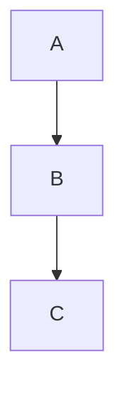

# GitHub Flavored Markdown (GFM) Example

Generated by ChatGPT (I can't be bothered to write all this out)

## Table of Contents

- [Headings](#headings)
- [Paragraphs](#paragraphs)
- [Text Formatting](#text-formatting)
- [Blockquotes](#blockquotes)
- [Lists](#lists)
- [Task Lists](#task-lists)
- [Links](#links)
- [Images](#images)
- [Code](#code)
- [Horizontal Rules](#horizontal-rules)
- [Tables](#tables)
- [Footnotes](#footnotes)
- [Escaping Characters](#escaping-characters)
- [HTML](#html)
- [Details](#details)
- [Emoji](#emoji)
- [Mentions](#mentions)
- [References](#references)
- [Alerts](#alerts)
- [Math](#math)
- [Autolinks](#autolinks)

---

# Headings

# H1

## H2

### H3

#### H4

##### H5

###### H6

---

# Paragraphs

This is a normal paragraph.

This is another paragraph separated by a blank line.

Line breaks can be forced by ending a line with two spaces.
Like this.

---

# Text Formatting

_Italic_

_Italic_

**Bold**

**Bold**

**_Bold Italic_**

**_Bold Italic_**

~~Strikethrough~~

**Bold with _nested italic_.**

> Inline `code` inside a sentence.

---

# Blockquotes

> This is a blockquote.
>
> It can span multiple paragraphs.
>
> > Nested blockquote.
> >
> > > Triple nested blockquote.

---

# Lists

## Unordered

- Apple
- Banana
- Orange
  - Mandarin
  - Clementine
    - Nested

* Another list

- Another style

## Ordered

1. First
2. Second
3. Third
   1. Nested
   2. Nested

## Mixed

1. Item
   - Bullet
   - Bullet
2. Item

---

# Task Lists

- [x] Completed
- [x] Another completed task
- [ ] Incomplete
- [ ] Another incomplete

---

# Links

Inline:

[GitHub](https://tangled.org)

Reference:

[GitHub Docs][docs]

[docs]: https://docs.tangled.org

Automatic:

<https://tangled.org>

Email:

<someone@example.com>

---

# Images


Image with title:


---

# Code

Inline:

`print("Hello")`

Indented code:

    def hello():
        print("Hello")

Fenced:

```
Plain text
```

Language highlighting:

```python
def greet(name):
    print(f"Hello {name}")
```

```javascript
function greet(name) {
  console.log(`Hello ${name}`);
}
```

```typescript
interface User {
  name: string;
}
```

```json
{
  "name": "example",
  "version": 1
}
```

```yaml
services:
  app:
    image: nginx
```

```bash
echo "Hello"
```

```diff
+ Added line
- Removed line
```



---

# Horizontal Rules

---

---

---

---

# Tables

| Left      |  Center  |   Right |
| :-------- | :------: | ------: |
| A         |    B     |       C |
| 1         |    2     |       3 |
| Long text | centered | aligned |

---

# Footnotes

Here is a sentence with a footnote.[^1]

Another footnote.[^long]

[^1]: This is the first footnote.

[^long]: Footnotes may contain multiple paragraphs.

    They may also contain lists.

    - One
    - Two

---

# Escaping Characters

\*Not italic\*

\# Not a heading

\`Not code\`

\\ Backslash

---

# HTML

<div align="center">

## HTML Works

You can mix HTML with Markdown.

</div>

<kbd>Ctrl</kbd> + <kbd>C</kbd>

<sub>Subscript</sub>

<sup>Superscript</sup>

<details>
<summary>Inline HTML Details</summary>

Hidden content.

</details>

---

# Details

<details>

<summary>Click to expand</summary>

This section is hidden until expanded.

### Markdown works inside

- Lists
- Code

```text
Hidden code block
```

</details>

---

# Emoji

Unicode:

😀 🚀 ❤️

GitHub shortcode:

:smile:

:rocket:

:tada:

:warning:

:white_check_mark:

---

# Mentions

@csw.im

#123

tangled.org/core#456

Commit:

ec170ad5a21e38036663a7e6482c0aa4cda40ed5

---

# References

Issue:

Fixes #12

Closes #15

Related to #20

---

# Alerts

> [!NOTE]
> Useful information.

> [!TIP]
> Helpful suggestion.

> [!IMPORTANT]
> Critical information.

> [!WARNING]
> Something to be careful about.

> [!CAUTION]
> Dangerous or destructive actions.

---

# Math

Inline math:

$E = mc^2$

Display math:

$$
\int_0^\infty e^{-x}\,dx = 1
$$

---

# Autolinks

https://tangled.org

tangled.org

mailto:someone@example.com

---

# Definition-style HTML

<dl>
  <dt>Markdown</dt>
  <dd>A lightweight markup language.</dd>

  <dt>GFM</dt>
  <dd>GitHub Flavored Markdown.</dd>
</dl>

---

# Mixed Formatting Example

> ## Quote Heading
>
> - **Bold**
> - _Italic_
> - `Code`
> - [Link](https://tangled.org)
>
> ```python
> print("Inside quote")
> ```

---

# Nested Everything

1. First
   - Bullet
     > Quote
     >
     > ```bash
     > echo "nested"
     > ```
     >
     > - [x] Task
     > - [ ] Task

---

# HTML Comments

<!--
This comment will not appear when rendered.
-->
